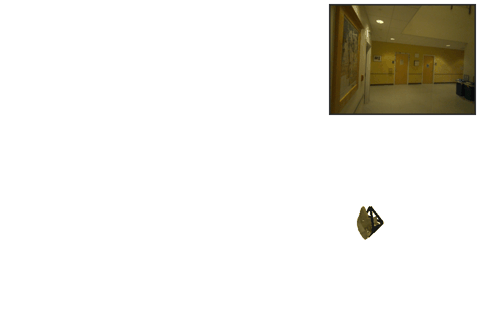
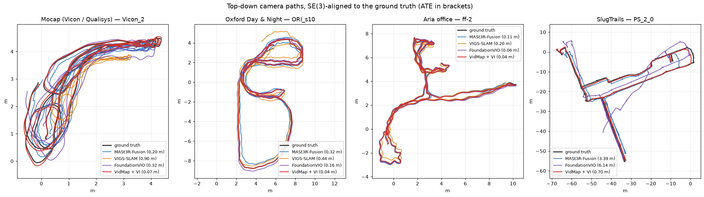

  <h1>Metric Trajectories and Maps from Egocentric Video + IMU: Validation</h1>
  

    Vignesh Radhakrishnan, Mark Hollands 
    School of Sport &amp; Exercise Sciences, Liverpool John Moores University, UK
  

  

  

Validation results so far: camera trajectories from egocentric video and IMU, compared with motion capture, Aria MPS and building floor plans on four datasets, and the dense ScaRF-SLAM maps built from them.

The results page is on the [website](https://vigneshrk29.github.io/trajectory-validation/). It shows the metrics, the pipeline, the datasets and models, ATE / W-AUC / RPE tables, the IMU-rate and EPO ablations, the trajectories and one map per dataset.

  

## Data

- Mocap (Vicon / Qualisys): our own recordings.
- [Oxford Day and Night](https://huggingface.co/datasets/active-vision-lab/oxford-day-and-night), CC BY 4.0.
- [Aria Office dataset](https://drive.google.com/drive/folders/1bxeWuI7iZ_19IX0bpkuoyeWR1ZS0f-a0), released with [FoundationVIO](https://github.com/ori-drs/FoundationVIO).
- [SlugTrails 1.0](https://huggingface.co/datasets/Head-inthe-Cloud/SlugTrails) (Cheng & Manduchi, [arXiv:2609.19876](https://arxiv.org/abs/2609.19876)), CC BY 4.0.

The camera frames shown were re-rendered from the original recordings as a Neon scene camera.
